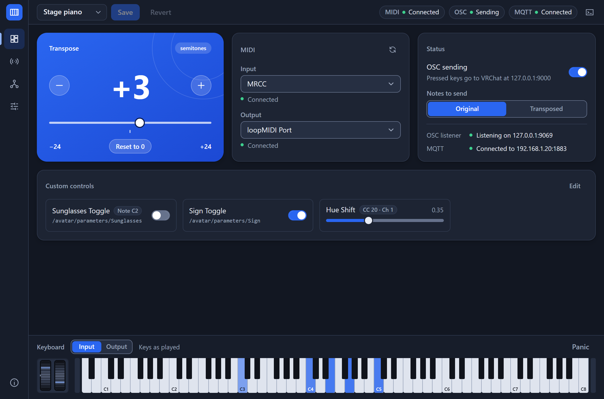

# VRC MIDI TRANSPOSER

  
   
  
  
  

VRC MIDI Transposer transposes MIDI in real time between two devices, mirrors the pressed keys to a VRChat avatar over OSC, and can be remote-controlled from VRChat, Home Assistant (MQTT) or its own console.

## Features

- 🎹 **Real-time MIDI transposition** with no stuck notes when the value changes while keys are held
- 🖥️ **Desktop app** for Windows, Linux (x86_64 and ARM64) and macOS with a dark, lightweight UI
- 🎛️ **Device selection** from a list, with automatic reconnect when a device is plugged in again
- 🎮 **VRChat OSC** in both directions: control transposition from VRChat and drive an avatar piano ([OSC_PARAMETERS.md](docs/OSC_PARAMETERS.md))
- 🎚️ **Custom controls** for any avatar parameter, switched or moved from the app, Home Assistant or your MIDI keyboard and knobs, with MIDI Learn
- 🎼 **Live keyboard** that shades each key by how hard you played it, plus pitch and mod wheel displays
- 🔁 **Arpeggiator and step sequencer** locked to the MIDI clock of your input or another device (or an internal tempo), with 9 arp styles, rates from 1/1 to 1/32 incl. dotted and triplets, a sequencer that starts on the next bar, step and live recording, and MIDI triggers for mode, Play and Record ([ARP_SEQUENCER.md](docs/ARP_SEQUENCER.md))
- 🏠 **Home Assistant over MQTT** with automatic discovery, including your own custom avatar controls
- 💾 **Project files** (`.vrcmt`): save complete setups anywhere, open them with a double-click, share them without your MQTT password
- 🔄 **In-app updates** on Windows, macOS and AppImage
- 🌍 **10 languages:** English, Deutsch, Italiano, 日本語, 简体中文, Français, Español, 한국어, Polski, Русский
- ⌨️ **Built-in console** with all commands, plus a `--headless` mode that runs without a window

## Install

Download the file for your system from the [latest release](https://github.com/marcus-universe/vrc_midi_transposer/releases).

| System | File |
|---|---|
| Windows 10/11 (64-bit) | `…_windows_x64-setup.exe` |
| macOS (Intel and Apple Silicon) | `…_macos_universal.dmg` |
| Ubuntu, Debian, Mint | `…_linux_<arch>.deb` |
| Fedora, openSUSE | `…_linux_<arch>.rpm` |
| Arch, SteamOS (Steam Deck: `x86_64`, Steam Frame: `aarch64`), other distributions | `…_linux_<arch>.AppImage` |

The builds are not signed with a paid certificate:

- **Windows:** SmartScreen shows a warning on first start. Choose *More info*, then *Run anyway*.
- **macOS:** right-click the app and choose *Open*, or allow it under *System Settings → Privacy & Security*.
- **AppImage:** make the file executable (`chmod +x`), then start it.

The ARM64 Linux builds are experimental; they are built and install-tested automatically but not tried on every device.

The AppImage cannot register the `.vrcmt` file type by itself. To open projects with a double-click, integrate it with [AppImageLauncher](https://github.com/TheAssassin/AppImageLauncher) or [Gear Lever](https://flathub.org/apps/it.mijorus.gearlever); otherwise use **Open…** in the app.

### Updates

The app checks for a new version at start (at most once a day; you can switch this off under **Settings**) or when you press **Check for updates** there.

| Installed from | Update |
|---|---|
| Windows setup, macOS `.dmg`, AppImage | **Install and restart** downloads the update, checks its signature, installs it and restarts the app |
| `.deb`, `.rpm` | The app tells you that a new version exists and links to the download page. Install it with your package manager or the new package. |

If your project has unsaved changes, the app asks to save them before it installs an update.

## Quick start

1. Start the app. It opens a new, untitled project. It uses the language of your system; change it under **Settings** if you like.
2. On the **Dashboard**, pick your MIDI input and output device.
3. Play. Change the transpose value with the buttons, the slider, the console, OSC or MQTT.
4. Optional: enable **OSC sending** to drive a VRChat avatar piano, and set up **MQTT** for Home Assistant.
5. Press **Save** (Ctrl+S) and choose where to keep the project file. Next time the app opens it again.

**Coming from version 2.0?** Your projects are converted once into `.vrcmt` files in `Documents/VRC MIDI Transposer`. The old folder stays as it was.

**Coming from version 1.x?** Use **Open…** in the project menu and select your old `config.json`. All settings, including listening and sending addresses and the MQTT broker, become a project; save it to keep it. OSC paths, MQTT topics and Home Assistant entities are unchanged, so your avatar and dashboards keep working.

## Documentation

- **[Projects and settings](docs/PROJECTS.md)**: project files, what a project contains, app settings and language, opening a `config.json`, headless mode
- **[Arpeggiator and sequencer](docs/ARP_SEQUENCER.md)**: modes, clock sources, arp styles and rates, the step sequencer, recording, MIDI control
- **[Control commands](docs/CONTROL_COMMANDS.md)**: every console command, OSC path and MQTT topic, and MIDI triggers for custom controls
- **[OSC parameters](docs/OSC_PARAMETERS.md)**: what is sent to VRChat
- **[VRChat avatar setup](docs/AVATAR_SETUP.md)**: building an avatar piano
- **[Home Assistant](docs/HomeAssistant.md)**: MQTT broker and Home Assistant setup
- **[Build guide](docs/BUILD_GUIDE.md)**: building from source, making a release and signing updates

## License

MIT, see [LICENSE](LICENSE). Made by Marcus Universe (<contact@marcus-universe.de>).

## Contributing & support

If this project is useful to you:

- ⭐ Give it a star so others can find it
- 🐛 Report bugs or suggest features in the GitHub issues
- 🔧 Pull requests are welcome
