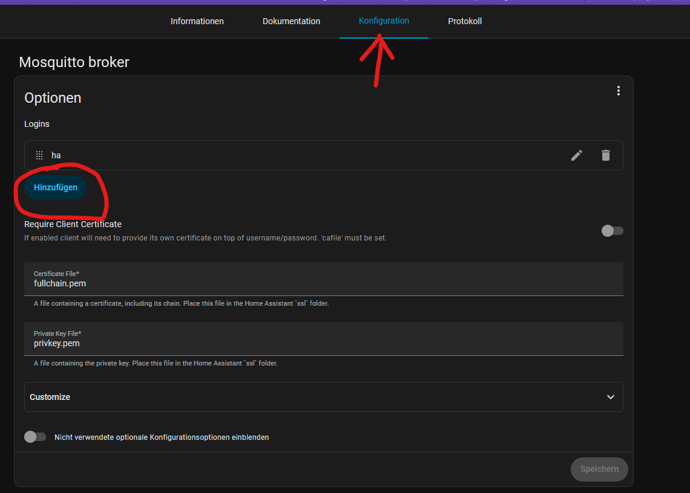
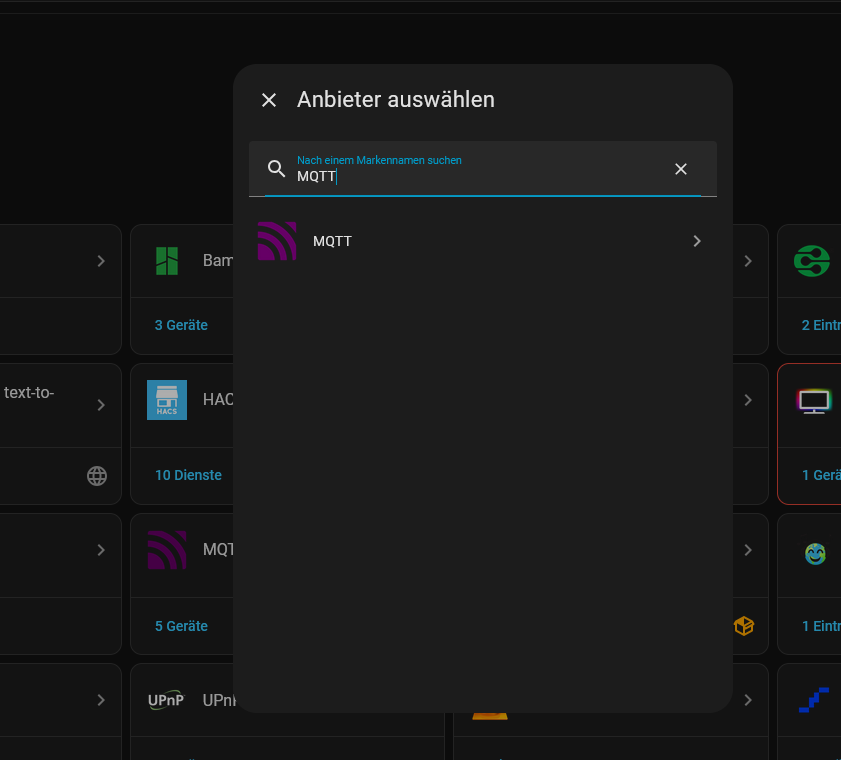
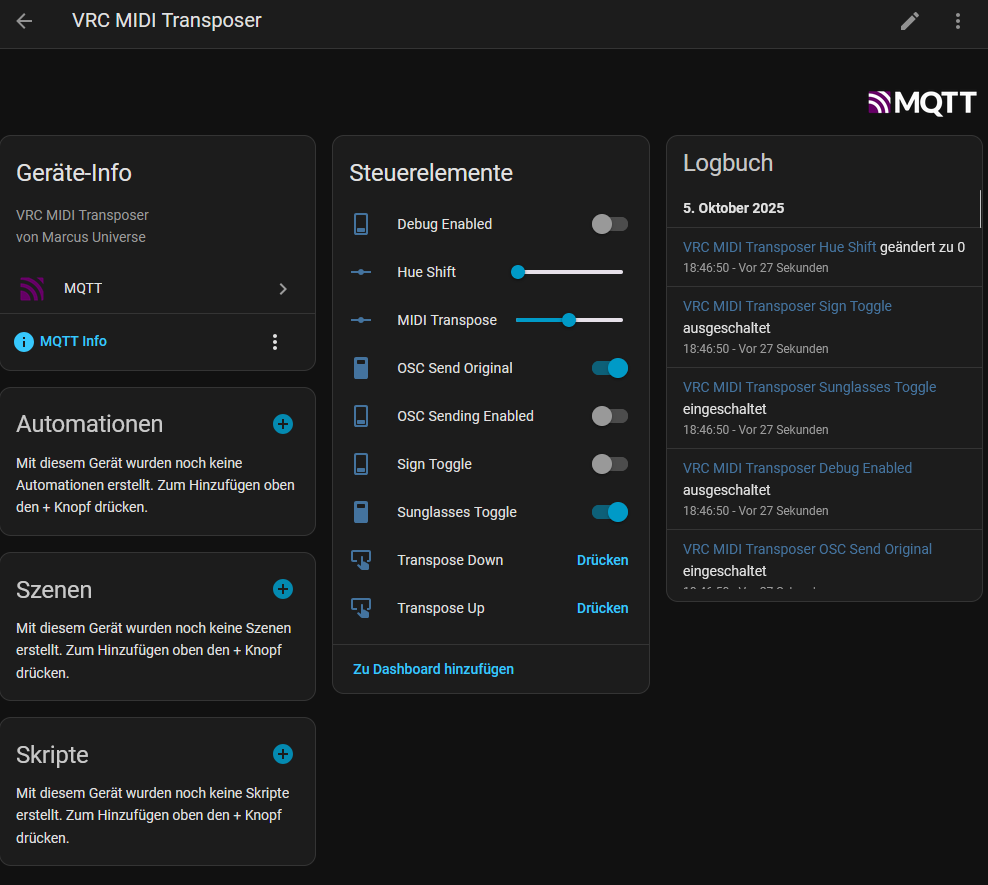

# Home Assistant Integration Guide

## Overview

This document explains how to connect the VRC MIDI Transposer to Home Assistant via MQTT. It provides a step-by-step guide for setting up the Mosquitto MQTT broker, configuring Home Assistant, and connecting your device using the `config.json`.

---

## 1. Setting up the Mosquitto MQTT Broker

### Installation

1. Download the MQTT add-on in Home Assistant: [mosquitto/DOCS.md](https://github.com/home-assistant/addons/blob/master/mosquitto/DOCS.md)
2. Install Mosquitto and start the service.
3. Open the Mosquitto console to check the status.


### Create a User

1. Create a user for MQTT (in Home Assistant under Settings → People → Users).
2. Note down the username and password for later configuration.



---

## 2. Enable Home Assistant MQTT Integration

1. Open Home Assistant and go to **Settings → Devices & Services → Add Integration**.
2. Search for "MQTT" and add the integration.
3. Enter the IP address of your MQTT broker, port (default: 1883), username, and password.
4. After a successful connection, Home Assistant should show the broker as connected.



---

## 3. Adjust config.json for the MIDI Transposer

Open your `config.json` and adjust the `mqtt` section as follows:

```json
"mqtt": {
  "broker_host": "192.168.1.100", // IP address of your MQTT broker
  "broker_port": 1883,
  "username": "your_user",
  "password": "your_password",
  "base_topic": "midi_transposer"
}
```

- **broker_host**: IP address or hostname of your MQTT broker
- **broker_port**: Default is 1883
- **username/password**: The credentials you created earlier
- **base_topic**: The base topic for all MQTT messages (e.g., "midi_transposer")

Save the file and restart the VRC MIDI Transposer.

---

## 4. Devices and Controls in Home Assistant

After starting the MIDI Transposer, the controls will automatically appear as new devices/entities in Home Assistant.

- The entities will appear under the name "VRC MIDI Transposer".
- You can use them directly in automations, dashboards, or scenes.



---

## 5. Troubleshooting

- **No entities visible?**
  - Check if the MQTT broker is running and Home Assistant is connected.
  - Check if the discovery topics are present in the broker (e.g., with MQTT Explorer).
  - Enable debug logging in the MIDI Transposer (`debug_enabled` set to `true`) to get more information.
- **Wrong credentials?**
  - Make sure the username and password in `config.json` are correct.
- **Firewall/Network?**
  - Make sure port 1883 (or your chosen port) is open.

---

## 6. Further Resources

- [Home Assistant MQTT Documentation](https://www.home-assistant.io/integrations/mqtt/)
- [Mosquitto Documentation](https://mosquitto.org/documentation/)
- [VRC MIDI Transposer GitHub](https://github.com/marcus-universe/vrc_midi_transposer)

---

With this guide, integrating your MIDI Transposer into Home Assistant should work smoothly!
